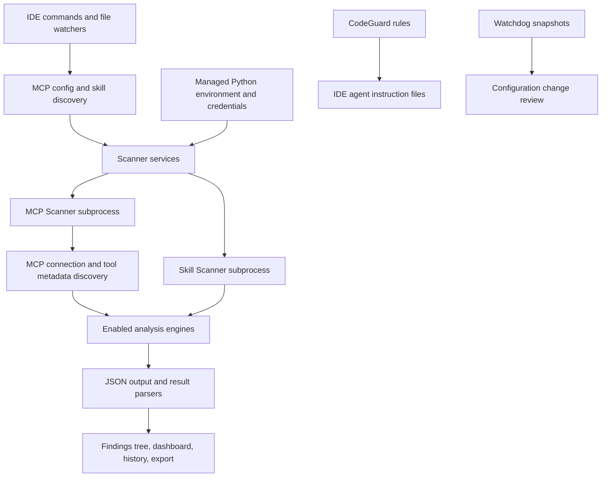

# Cisco IDE scanner: architecture and Antares compatibility

Checked 11 September 2026 through documentation, static inspection of the published VSIX, and the backend source versions referenced by that package. No extension was installed, no scanner was executed, and no MCP server was launched.

## Conclusion

**The inspected extension does not contain an Antares integration. Its subprocess-and-JSON architecture is a good approach for our own integration.** Using our model as a replacement for its generic LLM analyzer would not reproduce Antares's intended workflow.

The stronger evidence here supplements the earlier documentation-only [integration plan](vscode-integration-plan.md). It does not rule out future releases, custom user configurations, or undisclosed integrations.

## Evidence and reproducibility

The [Marketplace extension](https://marketplace.visualstudio.com/items?itemName=Cisco-AI.cisco-ai-security-scanner) is `Cisco-AI.cisco-ai-security-scanner`. Downloading the Marketplace `latest/vspackage` endpoint returned **version 1.0.6** during this inspection.

| Inspected artifact | Observation |
| --- | --- |
| `extension/package.json` | Publisher `Cisco-AI`, version `1.0.6`, entry point `dist/extension.js`, VS Code engine `^1.85.0`. |
| Package manifest and `LICENSE.txt` | Apache-2.0 declaration and accompanying Apache license text. This resolves the earlier uncertainty about the distributed extension's declared license. |
| `dist/extension.js` | Zero case-insensitive occurrences of `antares`; examined scanner services invoke MCP/Skill Scanner processes. |
| MCP backend installation constants | `cisco-ai-mcp-scanner` 4.6.0; repository `cisco-ai-defense/mcp-scanner`. |
| Skill backend installation constants | `cisco-ai-skill-scanner` 2.0.9; repository `cisco-ai-defense/skill-scanner`. |
| Command manifest | Scan/configuration/export commands, but no contributed Antares command or report-import command. No general analyzer-registration API was identified in the inspected bundle. |
| Source availability | The Marketplace's GitHub Issues link points to `cisco-sbg/mcp-scanner-plugin/issues`, which returned 404. The package contains compiled JavaScript, not the original TypeScript project or source maps. |

Reproducible package endpoint: [Cisco extension VSIX](https://marketplace.visualstudio.com/_apis/public/gallery/publishers/Cisco-AI/vsextensions/cisco-ai-security-scanner/1.0.6/vspackage). The inspected latest response used gzip transport encoding; hashes below refer to the decoded ZIP and extracted JavaScript, respectively.

```text
VSIX SHA-256:
2e0ae8ef0fac797d13a0592f0fbc15beb9731ba87fa335a3bf96975363cb0da0

dist/extension.js SHA-256:
414c4440d664ed88530c42055a894bb6e896a2404e1b37efc4081e9e6c5d16b4
```

The source tags resolved to MCP Scanner commit `30a3507fe92914c08b7ca217dc11d49641a0834f` and Skill Scanner commit `f726e6acd86fa2a997ed56cb046188ff9ae0d947`. These are the backend versions referenced by the VSIX; they are not a claim about every user's installed environment or newer backend releases.

## How it works



The package's Python manager detects or provisions Python, manages a virtual environment, supports uv/pip installation, and installs scanner backends. Scanner services build argument arrays and environment variables, spawn processes, collect output, apply timeouts, and normalize JSON into UI results. Those observations come from the distributed `dist/extension.js`, not just product descriptions.

The MCP service builds arguments equivalent to:

```text
mcp-scanner --analyzers yara,llm --raw --config-path <config>
```

Actual analyzers depend on settings and available credentials. The service can split a multi-server configuration into temporary per-server configurations for result grouping. Skill scanning invokes a separate executable with `scan <skill-path> --format json` and enabled-analyzer flags. The bundle also probes supported skill-scanner flags.

Documented engines include local YARA/static checks, behavioral analysis, optional LLM analysis, Cisco AI Defense, VirusTotal, and skill meta-analysis. CodeGuard supplies rules to coding-agent context; Watchdog tracks configuration changes. These are distinct features, not evidence that Antares scans generated source in the background. See the [engine/features reference](https://cisco-ai-defense.github.io/docs/ai-security-scanner/features) and [advanced features](https://cisco-ai-defense.github.io/docs/ai-security-scanner/advanced).

### The LLM path is a classifier, not an Antares harness

The pinned [MCP LLM analyzer](https://github.com/cisco-ai-defense/mcp-scanner/blob/4.6.0/mcpscanner/core/analyzers/llm_analyzer.py) constructs threat-analysis messages from tool content, calls LiteLLM, parses a structured response, and creates scanner findings. It does not drive Antares terminal exploration.

The pinned [Skill Scanner request handler](https://github.com/cisco-ai-defense/skill-scanner/blob/2.0.9/skill_scanner/core/analyzers/llm_request_handler.py) similarly sends chat messages through LiteLLM (or a Google SDK path), using a response schema or JSON-object fallback. The extension maps provider configuration into `MCP_SCANNER_LLM_*` and `SKILL_SCANNER_LLM_*` environment variables.

Ollama support and configurable model names make local inference possible, but they do not supply Antares's prompt, tool executor, repository snapshot, or final-submission protocol. An endpoint accepting HTTP requests is only transport compatibility. Reliable semantic/schema compatibility would still need testing. See [provider settings](https://cisco-ai-defense.github.io/docs/ai-security-scanner/settings).

### Discovery can execute server startup code

The [MCP CLI config path](https://github.com/cisco-ai-defense/mcp-scanner/blob/4.6.0/mcpscanner/cli.py) calls `scan_mcp_config_file`. In the pinned [scanner implementation](https://github.com/cisco-ai-defense/mcp-scanner/blob/4.6.0/mcpscanner/core/scanner.py), a stdio server config leads to `StdioServerParameters`, `stdio_client`, session initialization, and `list_tools()`.

Thus, avoiding tool invocation does not mean avoiding server startup: a configured local server command can run to expose metadata. Remote discovery also establishes a connection. This is a workflow distinction, not a claim that the extension deliberately invokes malicious tools. We have not performed a dynamic safety audit.

For our intentionally vulnerable FastMCP examples, source inspection should remain a separate operation that never starts those servers. Tool descriptions alone cannot establish whether an implementation validates audiences or enforces a scope inside a callback.

### Failure semantics need care

The pinned MCP LLM analyzer catches analysis exceptions, logs them, and returns an empty findings list. That creates a reason to track analyzer health separately from findings when designing our adapter. This source behavior alone does not establish exactly how every UI path displays such a failure.

Our extension should preserve Antares's incomplete result and exit status, including failures occurring after output was emitted. An empty candidate list must never erase an execution error.

## What we can reuse

| Element | Assessment for this POC |
| --- | --- |
| Extension → process → JSON → UI architecture | Adopt directly as a design pattern. Our CLI already offers `tool query --stdin` and `tool sweep --stdin`. |
| Separate environment management | Useful after MVP; initially use the existing installed Antares executable. |
| Tree/dashboard/history organization | Reuse the interaction pattern, adapting it to candidate files and review states. |
| SecretStorage/provider settings | Useful pattern for optional authenticated endpoints; keep local llama.cpp as default. |
| MCP and skill engines | Optional complementary backends, separate from Antares scans and their source-only boundary. |
| CodeGuard and Watchdog | Separate product capabilities; unnecessary for the first Antares integration. |
| Existing generic LLM slot | Not a drop-in Antares integration. Do not promise compatibility from a model-name override. |
| Existing extension as a plugin host | No supported external analyzer/result-registration API identified. UI commands are not an engine API. |
| Direct code reuse/fork | Distributed Apache-2.0 license is encouraging, but obtain the original source/build instructions and preserve applicable notices before planning a maintainable fork. |

## Concrete adaptation

Add an `AntaresScannerService` in our proposed extension, with the following boundary:

```text
VS Code command
  → selected repository + CWE + local model profile
  → spawn installed antares: tool query --stdin
  → Antares owns snapshot, inspection loop, and llama.cpp requests
  → validate returned JSON and process exit status
  → candidate-file view + run status + local history
```

Keep two explicit profiles: `antares-1b` on 8082 and `antares-350m` on 8086. The extension should own only its scan subprocesses; externally started inference servers remain user-managed.

Normalize results to run ID, engine, model, CWE, relative path, rank, execution status, and reviewer status. Do not translate Antares's taxonomy likelihood into confidence, fabricate line ranges, or convert candidate files into confirmed vulnerabilities. Our recorded OAuth false positives make those distinctions essential.

If Cisco later exposes an engine API or makes the original extension source accessible, this service can be adapted to that UI. There is no need to rewrite the agent loop or turn Antares into a chat classifier.

## Next validation steps

1. Exercise the installed CLI's JSON tool interface against one fixture per model and capture its exact output contract.
2. Build a minimal extension command with a subprocess adapter, cancellation, and a candidate Tree View.
3. Replay our completed, false-positive, and incomplete report fixtures through the UI before adding real scans.
4. Run the six OAuth variants with both models and preserve execution failures separately from security judgments.
5. Evaluate Cisco MCP/Skill Scanner independently on benign test assets if those capabilities are desired. Treat any live discovery as a separate, explicit operation.

Recommendation: proceed with the existing standalone plan using Cisco's architectural pattern. Do not replace the scanner's LLM with Antares as a shortcut. A dynamic test of that unsupported substitution would measure a different prompting task and would not validate our intended Antares workflow.
