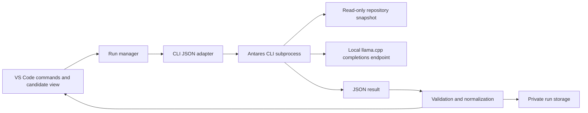

# VS Code integration plan for Antares

Research date: 11 September 2026. Status: roadmap; a local macOS MVP with automatic sweeps, guided review, and latest-run persistence is now implemented in [vscode-extension](../vscode-extension/README.md). See [validation](vscode-extension-validation.md) for tested scope. Later phases below remain proposals.

Current follow-up backlog: [script and extension improvement plan](reliability-improvement-plan.md), covering review persistence, freshness, resilient evaluation, named scan profiles, and setup UX.

Follow-up: [static inspection of Cisco scanner 1.0.6](cisco-ide-scanner-research.md) confirms a Python subprocess/JSON architecture and no identified Antares integration. It also verifies the distributed Apache-2.0 license and explains the live MCP discovery boundary.

## Recommendation

Build a small TypeScript desktop extension around the existing Antares CLI JSON interface. Connect to the local llama.cpp endpoints already working in this repository. Deliver manual CWE investigations and a reviewable candidate-file list first; add managed server startup and broader scans later.

Use Cisco's existing IDE scanner alongside it when MCP configuration and agent-skill inspection are needed. Do a short compatibility investigation before deciding whether an upstream integration is feasible. Do not make that investigation a dependency for the local POC.

## Existing Cisco products: research findings

| Project | Verified capability | Relationship to this POC |
| --- | --- | --- |
| [AI Agent Security Scanner for IDEs](https://marketplace.visualstudio.com/items?itemName=Cisco-AI.cisco-ai-security-scanner), publisher/ID `Cisco-AI.cisco-ai-security-scanner` | Available VS Code extension for MCP configurations, tool descriptions, and agent skills. | Relevant existing Cisco extension; an Antares integration was not documented in the listing reviewed. |
| [Cisco IDE scanner documentation](https://cisco-ai-defense.github.io/docs/ai-security-scanner) | Setup, analyzer selection, findings dashboard, history, and CodeGuard rule injection. | Existing UI and workflows to evaluate before duplicating broader scanner functionality. |
| [Cisco MCP Scanner](https://github.com/cisco-ai-defense/mcp-scanner) | Open-source MCP threat-analysis tooling. | Complementary engine for MCP-focused analysis; its presence does not establish Antares support. |
| [Cisco Skill Scanner](https://github.com/cisco-ai-defense/skill-scanner/blob/main/docs-site/index.mdx) | Agent-skill analysis, used by Cisco's IDE scanner. | Useful for skill packages; separate from the Antares source-localization loop. |
| [Cisco Antares](https://blogs.cisco.com/ai/introducing-antares-the-most-efficient-open-weight-ai-models-for-vulnerability-localization) | CWE-directed repository exploration and ranked candidate source files. | The engine this extension would expose. |

**Finding:** Cisco already offers a relevant security-scanner extension. I did not find a publicly documented Cisco Antares-specific VS Code extension or explicit Antares integration in that scanner. Searches covered the Marketplace, Cisco AI Defense documentation, and Cisco Foundation AI references. The scanner's listing and settings reference contained no Antares mention when checked. This is a bounded research result, not proof that no private, upcoming, or unindexed integration exists. This initial pass did not inspect a VSIX; the linked follow-up statically inspects version 1.0.6 without installing it.

The scanner documents LLM provider settings, including local Ollama, but that is not evidence of Antares compatibility. Our Antares setup uses an agent loop with repository inspection and the completions API. Simply selecting an Antares model name in another analyzer would not establish equivalent behavior. See [scanner provider settings](https://cisco-ai-defense.github.io/docs/ai-security-scanner/settings) and the [official Antares quickstart](https://github.com/cisco-foundation-ai/cookbook/blob/main/1_quickstarts/Quickstart_Antares.md).

### Build versus integrate

| Option | Benefit | Constraint | Decision |
| --- | --- | --- | --- |
| Run Cisco's scanner as-is | Immediate MCP/skill scanning in VS Code. | No verified Antares workflow. | Complementary evaluation. |
| Add an Antares engine to Cisco's extension | Could reuse its established UI. | The follow-up verifies the distributed Apache-2.0 license; original source/build access, contribution path, and a supported engine API remain unresolved. | Time-box a feasibility spike. |
| Standalone Antares extension | Direct fit to this POC; small, independently testable scope. | Own setup, result UI, and lifecycle handling. | Recommended MVP. |
| VS Code task plus report viewer | Fastest manual proof of integration. | Limited cancellation, history, and candidate-review experience. | Useful one-day spike or fallback. |

The feasibility spike should inspect the published extension manifest/license and documented APIs, check whether a supported external analyzer/result import exists, and test local-provider semantics. If no supported seam exists, retain a separate extension rather than depend on private commands. Contacting maintainers would be a separately authorized action.

## Product scope and user workflow

Initial platform: VS Code desktop on macOS/Apple Silicon, with this repository's installed CLI and a separately running local server. Linux, Windows, remote workspaces, browser VS Code, automatic downloads, and automatic remediation are later scope.

1. Open a trusted workspace and run **Antares: Configure**. Choose the CLI executable and a model profile: 1B on 8082 or 350M on 8086. Show connection status and where inference runs.
2. Run **Antares: Investigate CWE** from the palette or a folder context menu. In a multi-root workspace, select exactly one root/target. Choose a CWE or the OAuth preset (287, 441, 862).
3. Preview target, exclusions, model, endpoint, and budget. Offer to save dirty editors or scan the existing disk state; never silently imply unsaved buffers were analyzed.
4. Run one investigation with cancellable progress. Display stages and elapsed time, not fabricated percentage progress.
5. Review candidates grouped by run, CWE, and file. Open a file, inspect its result, mark it reviewed or dismissed, and export the report.
6. A later **Antares: Preview Coverage** command uses local `plan`; **Bounded Sweep** starts only after the user selects coverage.

No scan-on-keystroke in the MVP. Manual scans match the observed investigation latency and avoid noisy repeat findings. Saved-file scanning must be explicit in the UI.

### Result presentation

Use a native Tree View as the primary surface, an Output Channel for bounded/redacted process messages, and a read-only detail document. These can be built with the stable [VS Code APIs](https://code.visualstudio.com/api/references/vscode-api).

Antares currently reports file paths and rankings without source ranges. Do not invent vulnerable lines or code excerpts. Initially omit editor squiggles; an optional later Problems entry may use a clearly labeled file-level informational marker. `likelihood_of_exploit` is not model confidence, and rank is not a probability.

Maintain separate dimensions:

- Execution: queued, running, completed, incomplete, failed, cancelled.
- Review: unreviewed, confirmed by reviewer, dismissed by reviewer.
- Freshness: current snapshot or stale after source changes.

An empty incomplete result must say **Investigation incomplete**, not “No vulnerabilities.” Even completed empty results mean only “No candidates returned.” A cancelled rerun must not silently erase the previous completed result.

## Architecture



Keep the agent loop in Antares. The extension should never execute model-produced terminal commands itself. A language server, MCP server, or chat agent is unnecessary for the first version.

### CLI contract

The installed CLI's `commands/tool.py` and README expose `antares tool query --stdin` and `antares tool sweep --stdin`. Use this structured interface instead of parsing formatted terminal output. Invoke an absolute, user-configured executable with an argument array and `shell: false`; send JSON through stdin.

Example query request supported by the installed CLI:

```json
{
  "target": "/absolute/path/to/project",
  "cwe_ids": ["CWE-287"],
  "model": "antares-350m",
  "backend": "remote",
  "endpoint": "http://127.0.0.1:8086/v1/completions",
  "tool_budget": 10
}
```

For `tool sweep`, explicitly set `workers: 1` and `selection.max_cwes: 3`; the CLI defaults are larger. For local planning, use `plan <target> --format json`. Tool requests do not accept arbitrary regular CLI options such as an output-directory field. Persist the returned JSON in extension storage; verify the CLI's serialization interface separately before adding Markdown/SARIF export. Do not assume `tool` commands write the same report files as regular `query`.

The integration adapter must:

- Pin compatibility to the tested CLI version and validate the actual returned schema with runtime checks. Capture golden JSON fixtures from the installed `tool` commands before implementation depends on their shape.
- Read stdout and stderr separately, enforce bounded output sizes, and treat malformed/truncated JSON as an execution failure.
- Check process exit status plus warnings, generation errors, failed workers, incomplete reason, and per-CWE status. Preserve partial results on exit 2. A failure after output emission must not become a successful scan.
- Use an independent wall-clock deadline; tool budgets alone do not guarantee bounded completion. Start at 300 seconds for a query, with a separately bounded sweep deadline.
- Terminate the owned process group on cancellation, allow a short grace period, then force termination. Verify child cleanup and endpoint request cancellation experimentally; do not kill a user-managed server to cancel one scan.
- Queue requests per endpoint, with one active investigation initially. Never show raw model tokens as a percentage-complete signal.

Call the CLI directly rather than the current project wrapper: `scripts/antares.sh` forces history into this POC and clears the API key. The extension needs its own private history location and explicit connection settings.

### Configuration and storage

Proposed settings: `antares.cliPath`, `antares.model`, `antares.endpoint`, `antares.toolBudget`, `antares.queryTimeoutSeconds`, `antares.sweepMaxCwes`, and `antares.sweepWorkers`. Default to the existing 1B profile to match the project; offer 350M as a faster experimental option. Do not label 1B as proven more accurate on the basis of our tiny sample.

Treat executable paths and endpoints as user-controlled connection settings, not repository-supplied instructions. Store optional endpoint keys in SecretStorage and pass them only through the child environment. Avoid inheriting unrelated secrets, proxy settings, or conflicting Antares profiles.

Put reports and `ANTARES_DATA_DIR` under private extension storage outside every scan target. Store run UUID, workspace identity, model/revision or user-supplied identity, CLI version, request options, start/end times, and scanned-file hashes. A git commit alone misses dirty and untracked files. The CLI's request hash excludes source contents/model revision, so do not use it as a cache identity.

Default to bounded history, with a clear-history command and user-selected exports. Record suppression reasons against workspace, CWE, path, and content hash; changed content should reopen review. Do not ship source-bearing traces as telemetry.

## Security and deployment boundaries

VS Code extensions run with substantial host permissions. Disable execution in untrusted workspaces and restrict executable/endpoint settings; enforce checks in command handlers as well as menus. The platform provides [Workspace Trust APIs and manifest controls](https://code.visualstudio.com/api/extension-guides/workspace-trust).

The installed Antares CLI documents a read-only snapshot and allowlisted inspection commands. Keep that boundary and test it; it is not a claim of an OS-level container sandbox. Never run fixture servers, project startup commands, or MCP tools as part of a source investigation. Treat source text, tool output, report paths, and rendered Markdown as untrusted data.

Canonicalize finding paths, reject traversal and absolute/out-of-root paths, and handle symlinks and deleted files before opening editors. Render findings as inert text; disable command links and raw executable content.

The local-only default must reject unexpected remote endpoints and redirects. A later remote endpoint mode needs explicit destination disclosure because source excerpts can be sent there. Audit snapshot exclusions and merge `.antares.toml` settings without overwriting user configuration; `.gitignore` is not automatically applied. The [official quickstart](https://github.com/cisco-foundation-ai/cookbook/blob/main/1_quickstarts/Quickstart_Antares.md) describes these data boundaries.

For a future managed server, store the owned PID and model identity, verify the listening endpoint, bind loopback, detect port conflicts, and stop only that owned process. Do not bundle model weights in the VSIX or automatically accept gated-model terms. Keep model download and license handling explicit.

For Remote SSH/containers, the workspace extension host and `localhost` may be on another machine. Design the later remote version around an explicit execution-host/endpoint mapping, and test port forwarding and storage there. Browser-only VS Code cannot use this desktop subprocess design unchanged. See [VS Code remote development guidance](https://code.visualstudio.com/api/advanced-topics/remote-extensions).

## Implementation phases and acceptance gates

Planning estimates for one engineer familiar with this POC; dependencies and packaging issues may change them.

| Phase | Estimate | Deliverables | Acceptance gate |
| --- | --- | --- | --- |
| 0. Integration spike | 1–2 days | Evaluate Cisco extension reuse, capture actual tool-query/plan schemas, verify cancellation. | Document reuse decision; both local model profiles return parseable results through the proposed interface. |
| 1. Core adapter | 2–3 days | TypeScript scaffold, settings, process runner, schema validation, state machine, private storage. | Tests cover success, exit 2, malformed output, deadline, cancellation, and paths with spaces. |
| 2. Reviewable MVP | 2–3 days | Configure/query commands, model selector, progress, candidate tree, file navigation, JSON export. | Run SQL demo and six OAuth targets from Extension Development Host; incomplete results cannot appear clean. |
| 3. Workflow hardening | 2–3 days | Coverage preview, bounded sweeps, stale-result tracking, history, dismissals, trust/path protections. | Multi-root isolation, dirty-file handling, secret exclusion, no out-of-root navigation or leaked processes. |
| 4. Pilot packaging | 1–2 days | VSIX, user guide, compatibility declaration, release checklist. | Install into a clean VS Code profile and complete setup/tests using documented prerequisites. |
| Later | Separately scoped | Managed local server, Linux/Windows/remote support, SARIF export/import, optional Cisco interoperability. | Each feature has its own compatibility and data-boundary tests. |

Expected MVP/pilot effort: roughly 8–13 engineering days. Marketplace publication and maintainer collaboration are later decisions, not actions authorized by this plan.

Suggested layout:

```text
vscode-extension/
  package.json
  src/extension.ts
  src/configuration.ts
  src/cli/{runner,contracts,normalize}.ts
  src/runs/{manager,storage,freshness}.ts
  src/views/{candidates,details,status}.ts
  src/security/{trust,paths,environment}.ts
  test/{unit,integration,fixtures}/
```

Keep test fixtures copied/redacted from tracked reports; exclude binaries, weights, environments, and real run history from the VSIX.

## Validation strategy

Use deterministic fake-CLI tests for execution behavior and recorded JSON for rendering, plus real model runs as a separate optional test tier. Follow the official [VS Code extension testing workflow](https://code.visualstudio.com/api/working-with-extensions/testing-extension) for Extension Development Host integration tests.

1. Unit tests: request validation, schema compatibility, state transitions, stale results, deduplication, suppression expiry, URI containment, log redaction, and cancellation races.
2. Process tests: valid/invalid JSON, stdout noise, output limits, exit 2 with partial findings, hanging child processes, unavailable endpoints, wrong model aliases, and credentials absent from saved logs.
3. Editor tests: trust restrictions, multi-root selection, unsaved files, editor navigation without fabricated ranges, reload during a scan, and exporting an incomplete result.
4. Real local checks: the SQL demo and all six OAuth variants against both model profiles, using a fresh output directory and recorded provenance. Reuse the eight offline tests as the fixture behavior oracle.
5. Pilot checks: install/uninstall, configuration migration, no unexpected network calls, and storage cleanup on an isolated macOS user profile.

Do not make exact LLM findings a deterministic build gate. Our [1B results](../reports/fastmcp-oauth.md) contain two false positives and an incomplete control; [350M](../reports/antares-350m.md) flagged every control. Adapter/UI tests must preserve these outcomes accurately, rather than rewriting expected security results to make tests pass. A larger evaluation set is required before enabling automatic scans or stronger security claims.

## First implementation milestone

A developer installs a local VSIX, chooses the existing CLI and either model endpoint, runs one CWE investigation, cancels or completes it, and reviews correctly attributed candidate files with an exportable JSON result. No cloud service or Cisco scanner installation is required for that milestone.
